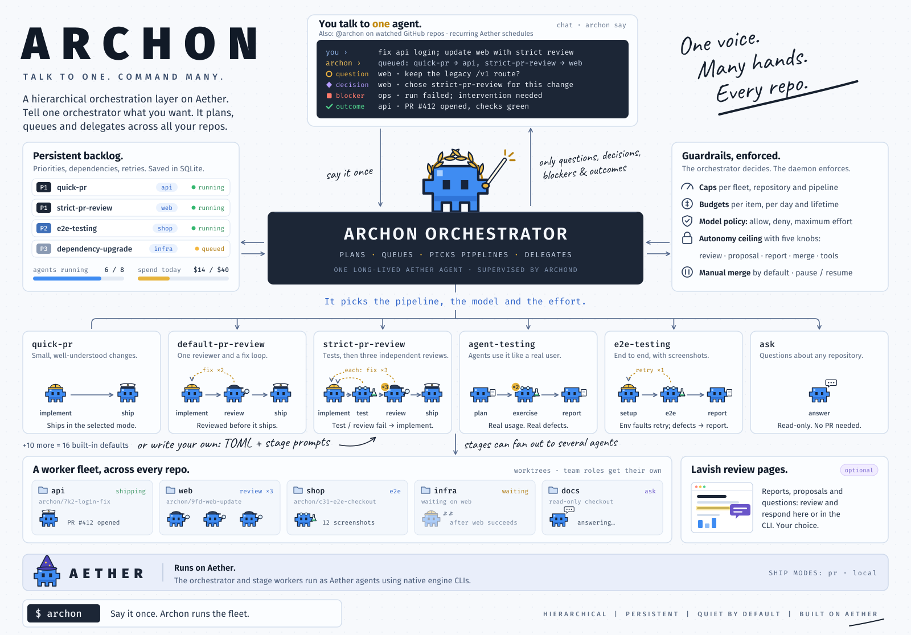

# Archon

Archon turns requests into reviewed pull requests. You describe the work to
one orchestrator agent; Archon queues it, runs each item through a pipeline
of agent stages (implement, test, independent review, fix loops) in its own
git worktree, and ships the verified commit itself. The daemon, not the
agents, enforces your budgets, model policy, required review and autonomy
ceiling. Agents run on [Aether](https://github.com/mengsig/aether).



- **Talk to one agent.** Chat in the terminal UI, send one-off requests from
  the CLI, or mention `@archon` on a watched GitHub repository. The
  orchestrator answers code questions from its own copy of your
  repositories and queues every change as an item.
- **Pipelines with real gates.** Ten built-in pipelines, from a single
  agent with no reviewer to a lead with three independent ones, or your own
  in TOML. A failed gate sends the findings back to the implementer, which
  keeps its context through the fix.
- **`archond` ships, not an agent.** It delivers only the tree the reviewers
  read, made under your git identity, pushes without ever forcing, and
  opens or reuses the pull request; a restart never opens a second one.
- **Steer without restarting.** Amend the brief, change a model, budget or
  deadline, or insert, remove or switch the stages still to run.
- **Stacks and initiatives.** An item that depends on another is stacked on
  its branch and restacked when the parent merges. A change across
  repositories is one initiative built to a shared contract.
- **Learns what passes.** Finished runs leave outcomes; Archon fills
  unplanned stages with the models that passed for the repository and
  hands agents short lessons, as advice that grants nothing.

## Install

```sh
curl -fsSL https://raw.githubusercontent.com/mengsig/archon/main/install.sh | sh
```

Linux or macOS. The installer puts `archon` in `~/.local/bin` and offers to
install Aether, which Archon needs. You also need git 2.38 or later, one
engine CLI ([Claude Code](https://code.claude.com/docs/en/quickstart) or
[Codex](https://github.com/openai/codex)) that you have logged in to, and
the [GitHub CLI](https://cli.github.com/) for pull requests.
[Lavish](https://github.com/kunchenguid/lavish-axi) review pages are
optional. Update with `archon update`. Other methods, every program Archon
can use, and building from source are in
[Installing Archon](docs/install.md).

## Quick start

From the root of a GitHub checkout where you can push a branch and open a
pull request (with a commit, an `origin` remote and your git name and
e-mail set), and logged in to your engine (run `claude` once):

```sh
gh auth login
archon setup
archon aether models    # the configured orchestrator model must be listed
archon repo add . --name example --ship pr
archon doctor
archon
```

If the orchestrator's model is missing from the list,
[choose another](docs/configuration.md#select-an-available-model) first.
`archon` opens the terminal UI on the orchestrator. Ask, for example:

> In repository example, add a short guide to the existing test commands, with one reviewer. Run each command it names and open a pull request. Do not merge.

The orchestrator queues it on `direct` at review level `standard`: one agent
writes and checks the guide, has it reviewed independently, and Archon ships
it; the orchestrator reports the pull request. Answer its questions in
place. `/quit` leaves and the work continues. `archon say "…"` sends one
request and exits, and `archon chat` is a line chat for SSH and scripts.
Commands start `archond` and Archon's own Aether instance when needed.

## How it works

- **Item:** one queued task with a brief, priority, dependencies, model
  plan, budget and optional repository.
- **Pipeline:** the stages an item runs, each an agent with its own prompt.
  A **gate** holds the run on stage verdicts or your approval, and can send
  it back to fix.
- **Review level:** `none`, `standard` or `strict`. With no pipeline named
  an item runs `direct`. `direct`, `adaptive` and `swarm` delegate no, one
  or three reviewers as the item's level asks. Any other pipeline's level follows its
  gated stages, not a reviewer count: a gated review or test stage makes it
  `standard`, both make it `strict`, so `refactor` is `strict` with one
  reviewer.
- **Delivery:** in `pr` mode `archond` pushes the run branch and opens a pull
  request, and the item succeeds once that pull request is open. It does
  not wait for your CI or repair a failing check: ask for a fix, or run
  `archon queue retry <id> --append "…"`, which delivers into the same pull
  request.
  With `merge = auto` GitHub merges once its checks allow. Otherwise
  `archon merge <item>`, or asking the orchestrator and confirming, merges
  it at the reviewed commit; a repository's `grant_merge` skips the
  confirmation. `local` mode keeps the commits on the run branch.
- **Initiative:** a member item per repository, one shared contract, and
  pull requests linked to each other. An atomic initiative keeps them
  drafts until every member passes, then marks them ready together. That
  is not an atomic merge: you merge the set, and `merge = auto` is refused.
- **Autonomy:** five knobs (review, proposal, report, merge, tools) that the
  orchestrator sets per item, never above the ceiling only you can raise.

| Pipeline | Stages | Independent checking |
| --- | --- | --- |
| `direct` | one agent implements, checks and commits: a fix, a feature, tests, docs or an upgrade | as the item's level asks; none by default |
| `adaptive` | one lead builds, delegates and integrates | as the item's level asks; one reviewer by default |
| `swarm` | a strong planner splits the change into tasks, cheap workers build them in parallel, a strong lead integrates | as the item's level asks; one reviewer by default |
| `refactor`, `performance` | baseline or measure → change → verify → review | a test gate and one reviewer |

`agent-testing`, `e2e-testing`, `code-audit`, `design-doc`, `ask` and
`errand` test, audit, design and answer without shipping. See the
[pipelines in the guide](docs/guide.md#pipelines), and
[write your own](docs/PIPELINES.md#quick-start-add-a-pipeline) for every
repository or for one, such as the
[`team-pr` example](docs/examples/pipelines/team-pr/pipeline.toml) of a plan,
a backend and frontend team, an e2e gate and a review.

## Everyday commands

| Command | Purpose |
| --- | --- |
| `archon` / `archon say "…"` | Open the terminal UI, or send one request |
| `archon status` | Health, capacity, spending and waiting work |
| `archon queue list` / `queue show <id> --full` | Items and their stage results |
| `archon queue steer <id> --note "…"` | Change a running item without cancelling it |
| `archon queue retry <id>` / `queue cancel <id>` | Run an item again, or stop it |
| `archon questions` / `archon answer <n> "…"` | Answer what the agents ask you |
| `archon merge <id>` | Merge a delivered pull request at its reviewed commit |
| `archon log --item <id> --follow` | Follow one item's events |
| `archon cost --since 7d --by repo` | Spending by repository |

An item id's unique prefix works too. The [user guide](docs/guide.md) covers
the rest, and [queue scripting](docs/queue-scripting.md) enqueues from files.

## Configuration and safety

`~/.config/archon/config.toml` on Linux (`ARCHON_CONFIG_DIR` overrides it)
sets the orchestrator's model, an optional model allowlist, limits and
budgets, autonomy defaults and ceiling, and worktree cleanup; a
repository's `.archon/config.toml` can narrow them. See the
[configuration reference](docs/configuration.md).

Agents cannot raise the ceiling through MCP. Merging is manual unless both
the ceiling and the item allow it. Worktrees are not sandboxes, but the
daemon's own git (delivery, restacking, worktree removal) runs no hook,
filter, merge driver or fsmonitor that a repository or worktree configures;
its push and fetch use your global git config and `GIT_SSH_COMMAND`. Budgets
act on recorded usage, which can arrive late, so they are not prepaid
limits. The GitHub watcher accepts only human writers, maintainers or
admins, and only logins you configure carry your authority, which archond
verifies itself ([operator authority](docs/operator-authority.md)). Read
[SECURITY.md](SECURITY.md) and the
[GitHub watcher guide](docs/github-watcher.md) before widening access.

## Documentation

[User guide](docs/guide.md) · [Install](docs/install.md) ·
[Configuration](docs/configuration.md) · [Pipelines](docs/PIPELINES.md) ·
[Queue scripting](docs/queue-scripting.md) ·
[GitHub watcher](docs/github-watcher.md) ·
[Operator authority](docs/operator-authority.md) · [Architecture](docs/ARCHITECTURE.md)

Project version: **1.3.2**. Licensed under [MIT](LICENSE). For development,
see [CONTRIBUTING.md](CONTRIBUTING.md).
