# Remote access: the mobile web app

archond can serve a mobile web app: the queue, each item's stages and
verdicts, the operator chat, the questions and gates waiting on you, and
the actions you take every day, on your phone. This page is the reference:
what is served, how a device is paired and authenticated, and what a
paired device may do. To set it up, follow
[Use Archon from your phone](remote-setup.md).

Remote access is **off** until you switch it on. When on, archond listens on
loopback only (`127.0.0.1:8378`); `tailscale serve`, or an HTTPS reverse
proxy you run, publishes it. A paired device gets **no authority of its
own**: each request it sends is checked against a fixed list
([what a device may do](#what-a-device-may-do)) and then handled exactly as
the same request from your `archon` CLI, so archond's own rules apply
unchanged.

## Contents

- [Screens](#screens)
- [Threat model](#threat-model)
- [Configuration](#configuration)
- [Pairing](#pairing)
- [HTTP endpoints](#http-endpoints)
- [The WebSocket](#the-websocket)
- [What a device may do](#what-a-device-may-do)
- [Revoking and switching off](#revoking-and-switching-off)
- [Commands](#commands)

## Screens

The app at a phone's size, light and dark. `make e2e` regenerates nothing;
`node scripts/screens.js` in `crates/archon-remote/web` does.

| Screen | Light | Dark |
| --- | --- | --- |
| **Pairing**: Type or scan the one-time code and name the device. | 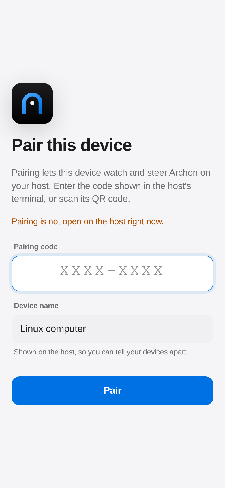 | 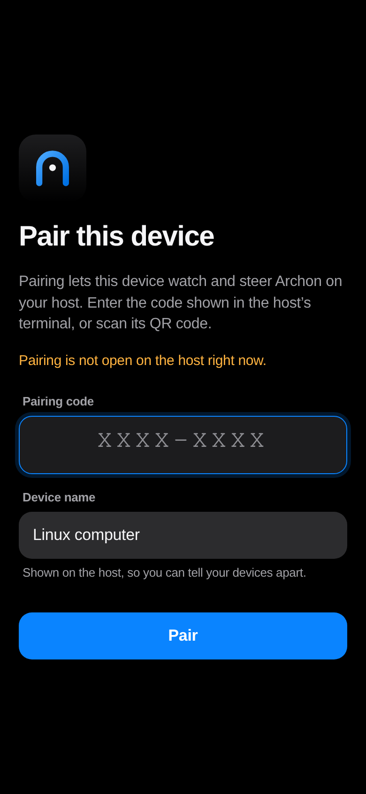 |
| **Queue**: Items with what each waits on; filter by state, held-up items, repository, pipeline and priority, or search. | 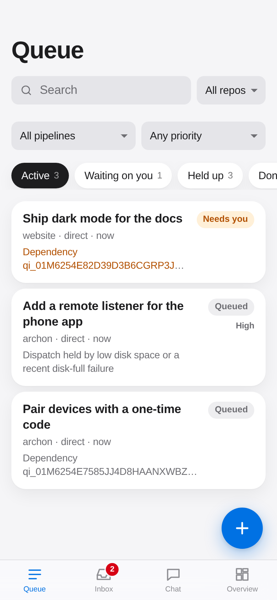 | 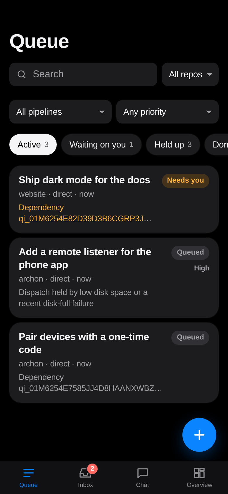 |
| **Item**: Stages, verdicts, cost, pull request and artifacts; cancel, retry and pause. | 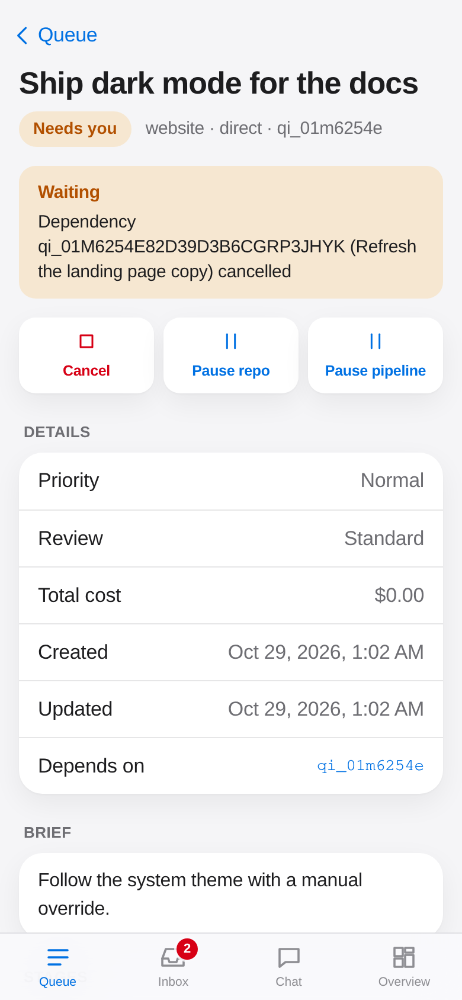 | 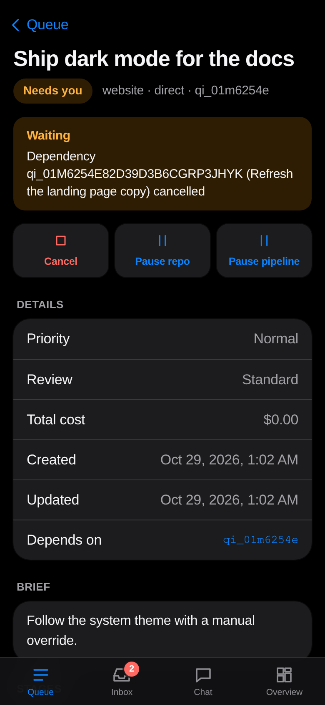 |
| **Inbox**: Questions, including stage gates, and notifications waiting on you, answered in place. | 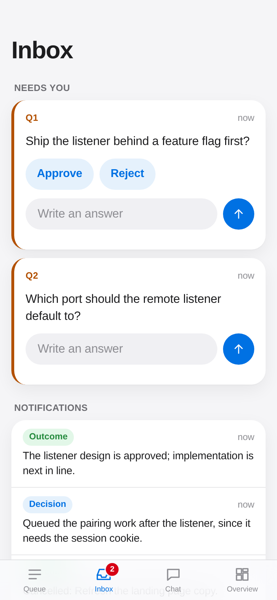 | 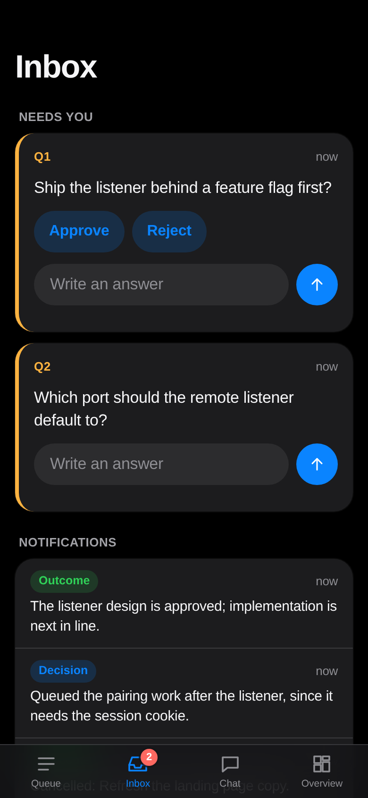 |
| **Chat**: The operator chat with the orchestrator, live. | 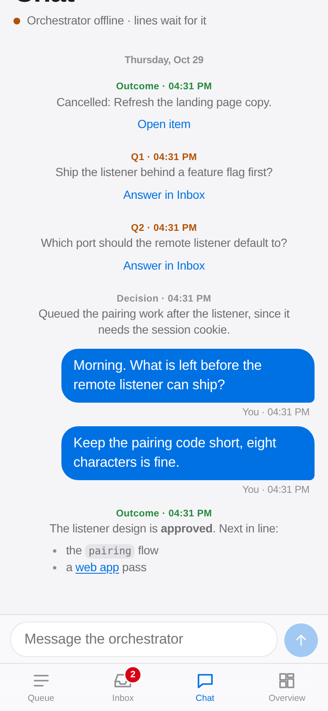 | 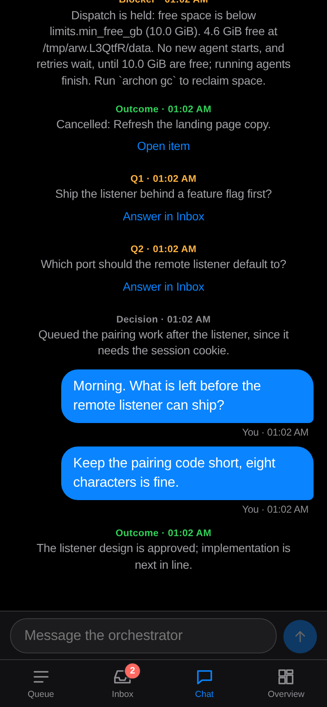 |
| **New item**: Enqueue with repository, title, brief, pipeline, priority and review level. | 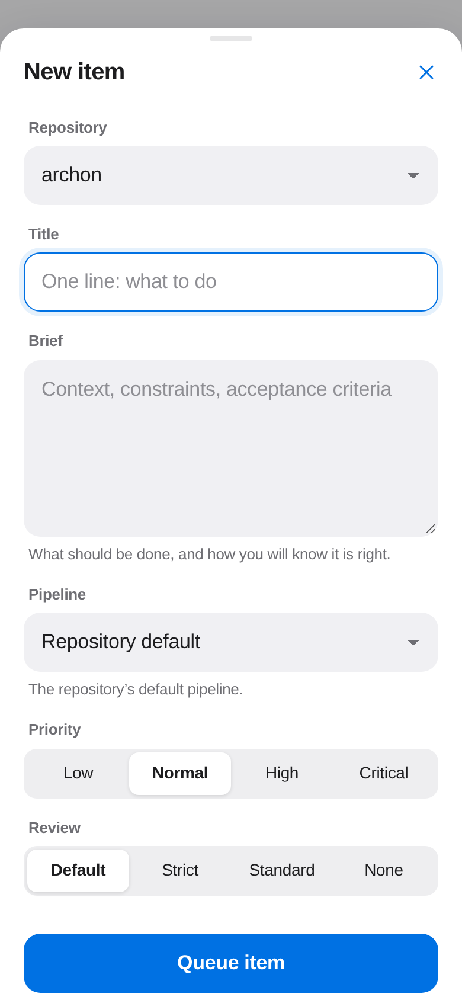 | 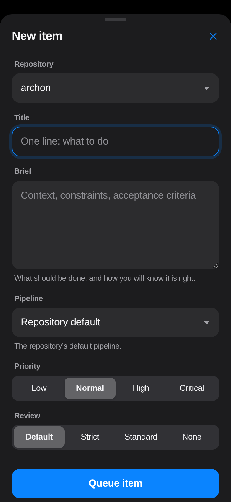 |
| **Overview**: Agents against caps, budgets and spend, repositories and pipelines; pause and resume. | 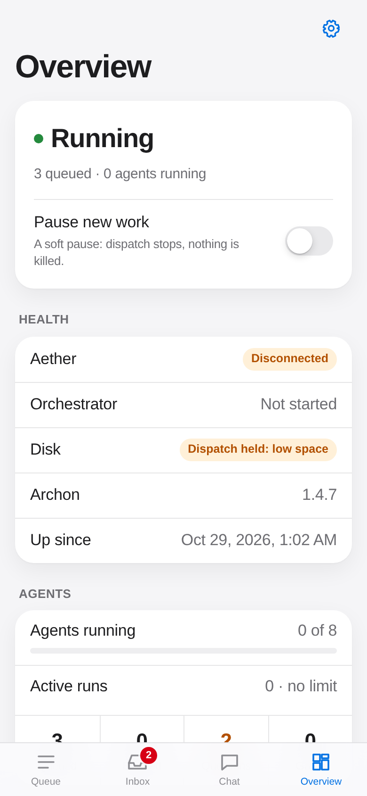 | 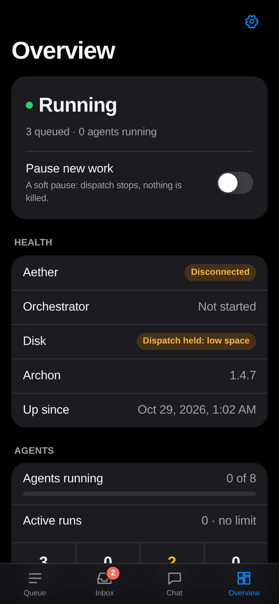 |
| **Settings**: Theme, this device and the versions; forget this device. | 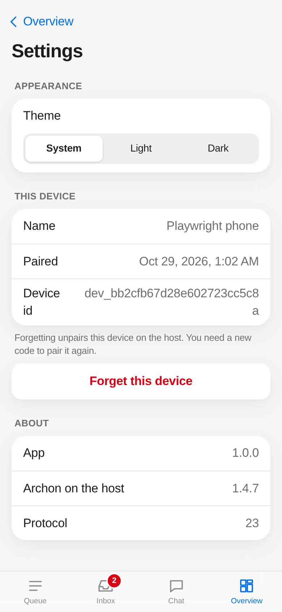 | 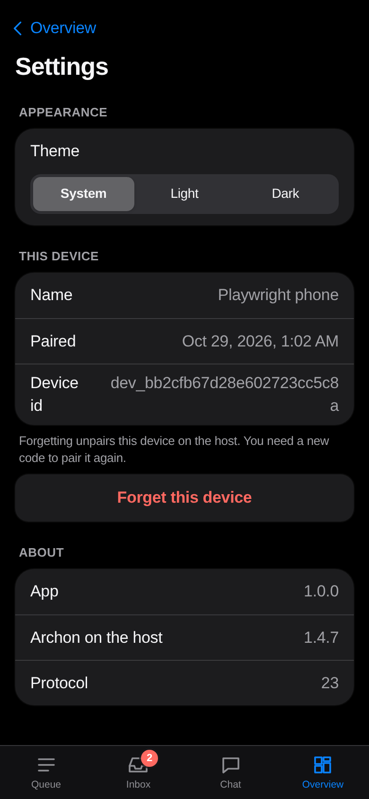 |

## Threat model

What remote access protects, and from whom:

- **Someone who can reach the address but holds no credential** (another
  device on your tailnet, a local user on this machine, a browser tab on a
  hostile site). They get the app's static files and `GET /api/health`,
  nothing else. Every API call and the WebSocket need a paired device's
  credential. Pairing needs the one-time code that only `archon remote
  pair` (or `setup`) shows on your terminal.
- **Guessing the code.** It is 8 symbols of Crockford base32 (40 bits), open
  for 5 minutes, used once. Guesses are limited to 3 per 10 seconds across
  all clients (`429` with `Retry-After`), and the fifth wrong code closes
  the pairing. In 5 minutes at most 90 guesses are possible, a chance of
  about 1 in 10¹⁰.
- **Cross-site requests and DNS rebinding.** Every request's `Host` must be
  an origin archond was told about (the public origins you added, or
  loopback on the listening port), so a hostile name pointed at
  `127.0.0.1` is refused. A `POST` and the WebSocket upgrade need an
  allowed `Origin` and, when the browser sends it, `Sec-Fetch-Site:
  same-origin`. Bodies must be `application/json`, which a cross-site form
  cannot send. The credential cookie is `HttpOnly` and `SameSite=Strict`.
- **A stolen credential.** Each device has its own 256-bit secret. archond
  stores only its SHA-256, in `remote.json` (mode 0600) under its data
  directory. `archon remote revoke` forgets the device and closes its open
  sessions at once (WebSocket close code 4401).
- **A paired device doing more than you could.** It cannot: requests outside
  the [list](#what-a-device-may-do) are refused with `forbidden`, and the
  rest go through archond's operator checks as the CLI's do. Merges,
  promotions, settings, autonomy ceilings, repository registration, gc,
  upgrades and remote access itself stay on the CLI. A merge the
  orchestrator proposes still waits for the confirmation question it
  always asks, which you may answer from the app as from the chat.
- **Secrets in URLs and logs.** The pairing link carries its code in the
  URL fragment (`/pair#code=…`), which browsers never send to a server or a
  proxy. No credential is ever in a URL; the app's own files live under
  fixed paths. archond logs device ids, never codes or credentials.
- **Exposure.** The listener binds loopback unless you set
  `allow_remote = true`, and serves plain HTTP: TLS is the proxy's job.
  The setup wizard publishes only to your tailnet with `tailscale serve`,
  never with Funnel, and refuses to reuse a port Funnel opens to the
  internet.

What it does not protect against: anyone who can run commands as you on
this machine (they can use the CLI and read the data directory anyway), a
compromised phone while it is paired, and a proxy you configure to forward
someone else's traffic. Off a tailnet, put your own authentication in front
of the proxy too.

## Configuration

Static settings live in `config.toml`; a change needs an archond restart.

```toml
[remote]
address = "127.0.0.1:8378"   # where the listener binds
allow_remote = false         # true to bind a non-loopback address
max_connections = 16         # HTTP connections served at once (1 to 1024)
```

`allow_remote = true` lets the listener bind a non-loopback address. The
listener still speaks plain HTTP and still checks `Host` and `Origin`; use
it only on a network you trust, behind a TLS proxy.

What changes at run time is kept in `remote.json` in archond's data
directory, mode 0600, written through a private temporary file:

| Field | Meaning |
| --- | --- |
| `enabled` | Whether the listener opens when archond starts. |
| `public_origins` | The `https://host[:port]` origins browsers may use besides loopback, at most 16. |
| `devices` | The paired devices: `id`, `name`, `secret_sha256`, `paired_at`, `last_seen_at`. At most 64. |

A `remote.json` that does not parse stops archond with the path and the
fix: move it away to reset remote access. An open pairing code lives only
in archond's memory and never outlives it.

## Pairing

1. `archon remote pair` (or `archon remote setup`) opens a pairing and
   prints its code (`7K2M-9QXD`), a QR code of
   `https://<origin>/pair#code=7K2M-9QXD`, and every address it works at.
   A new pairing replaces any open one.
2. The phone opens the link (or `/pair` and you type the code), names
   itself, and sends `POST /api/pair/claim`.
3. archond checks the code (case, dashes and spaces ignored; `O` reads as
   `0`, `I` and `L` as `1`), closes the pairing, stores the new device, and
   answers with its credential in a cookie.

The code must be claimed within 5 minutes. A wrong code counts towards the
5 that close the pairing; an expired or closed pairing needs a new
`archon remote pair`.

## HTTP endpoints

Every response carries `Content-Security-Policy: default-src 'none';
script-src 'self'; …; frame-ancestors 'none'`, `X-Content-Type-Options:
nosniff`, `X-Frame-Options: DENY`, `Referrer-Policy: no-referrer`,
`Cross-Origin-Opener-Policy` and `Cross-Origin-Resource-Policy: same-origin`,
and a `Permissions-Policy` that turns off the camera, microphone and geolocation.
API responses are `Cache-Control: no-store`.

Checks, in order: the `Host` (403 `forbidden_host`), the path (400 on empty,
`.` or `..` segments, backslashes or `%` escapes), the method (405), then
the endpoint's own. Request heads must arrive within 10 seconds and be at
most 32 KiB; bodies at most 16 KiB (413) within 10 seconds. Errors are
`{"error": {"code", "message"}}`.

| Endpoint | Needs | Answers |
| --- | --- | --- |
| `GET /api/health` | — | `{"status":"ok","pairing_open":bool,"version"}` |
| `POST /api/pair/claim` | Origin, JSON `{"code","device_name"}` | `200 {"device":{id,name,paired_at}}` and `Set-Cookie`; `403 invalid_code` or `pairing_closed`, `410 expired`, `429 rate_limited` |
| `GET /api/session` | the cookie; same-site | `{"device","protocol_version","daemon_version"}`; `401` (and a cleared cookie) when not paired |
| `POST /api/session/forget` | Origin, the cookie | unpairs this device and clears the cookie |
| `GET /ws` | Origin, the cookie, subprotocol `archon` | the WebSocket |
| `GET /…` | — | the app's files, with an `ETag`; a path without an extension serves `index.html` |

The cookie is `archon_device=<id>.<secret>; Path=/; HttpOnly;
SameSite=Strict; Max-Age=34560000`, plus `Secure` when paired over HTTPS.
`device_name` is 1 to 64 characters, whitespace folded; control,
invisible, bidirectional and private-use characters are refused.

## The WebSocket

`GET /ws` upgrades to a WebSocket with the subprotocol `archon` (version
13 only). It carries archond's own protocol
([ARCHITECTURE §10](ARCHITECTURE.md)), one JSON frame per text message: the
first message must be `hello` with archond's protocol version (23), and
archond answers `welcome`. After that each `{"req": N, "cmd": …}` is
answered by a `reply` frame with the same id, and `subscribe_feed` streams
`feed` frames, as on the Unix socket.

Limits: messages of at most 1 MiB, 16 requests in flight and 4 feed
subscriptions per connection, and as many sessions in total as
`max_connections`. archond pings every 25 seconds and closes a session
silent for 75.

| Close code | Meaning |
| --- | --- |
| 4401 | This device was revoked; pair again. |
| 4403 | Remote access was switched off. |
| 4002 | An allowed origin was withdrawn; the app reconnects and is checked again. |
| 1001 | archond is stopping. |
| 1008 | A protocol violation (no `hello` first, a wrong version). |
| 1009 | A message over 1 MiB. |

## What a device may do

The app may send these requests, and only these:

| Reads | Changes |
| --- | --- |
| `status`, `repo_list`, `list_items`, `list_item_summaries`, `get_item`, `get_stage`, `resolve_item`, `list_pipelines`, `list_questions`, `feed_history`, `subscribe_feed`, `list_reports`, `orchestrator_status`, `cost_report`, `list_artifacts`, `read_artifact`, `item_diff`, `settings`, `autonomy` | `enqueue`, `cancel_item`, `retry_item`, `pause`, `resume`, `answer`, `say` |

Each is handled as the operator CLI's request, so archond applies the same
checks and records the same feed lines; `say` reaches the orchestrator as
your chat line does, and `answer` answers a question or gate as `archon
answer` does. Everything else, including a second `hello`, is refused with
`forbidden` and the message "… is not available from the web app; use the
archon CLI".

## Revoking and switching off

- `archon remote revoke <id or name>` forgets one device and closes its
  sessions at once; its cookie no longer works. "Forget this device" in the
  app does the same for the phone in your hand.
- `archon remote disable` closes the listener, every session (4403) and any
  open pairing. Paired devices are kept, and work again after `archon
  remote enable`.
- `archon remote origin remove` and `archon remote setup --local` close
  every open session (4002) when they withdraw an origin, since origins are
  checked when a session opens; sessions from origins still allowed reconnect.
- A `tailscale serve` that still points at a closed listener answers `502`.
  Remove it with `tailscale serve --https=<port> off`.

## Commands

| Command | Does |
| --- | --- |
| `archon remote` (`status`) | Whether the listener is on, its origins, and the paired devices. |
| `archon remote setup` | The guided setup ([remote-setup.md](remote-setup.md)). |
| `archon remote enable` / `disable` | Open or close the listener. |
| `archon remote pair` | Open a pairing code and show its QR code. |
| `archon remote devices` | The paired devices. |
| `archon remote revoke DEVICE` | Unpair one device. |
| `archon remote origin add URL` / `remove URL` | Allow or drop an `https://` origin. |

Every command takes `--json`. archond serves them as operator-only
requests (`remote_status`, `configure_remote`, `remote_pair`,
`remote_revoke`), which neither the MCP proxy nor a paired device may send.
